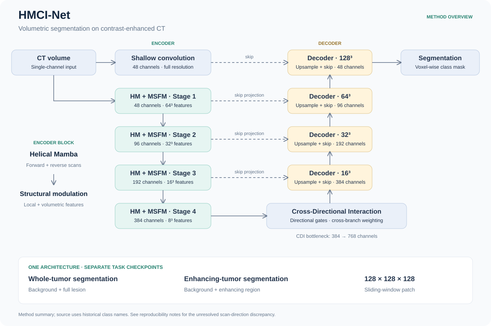
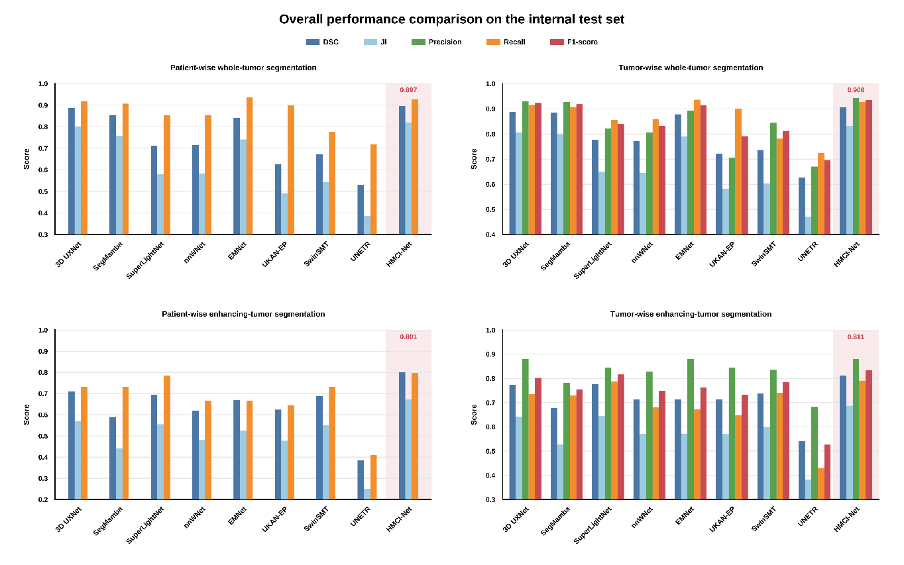
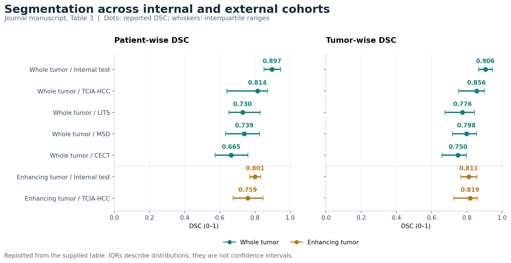
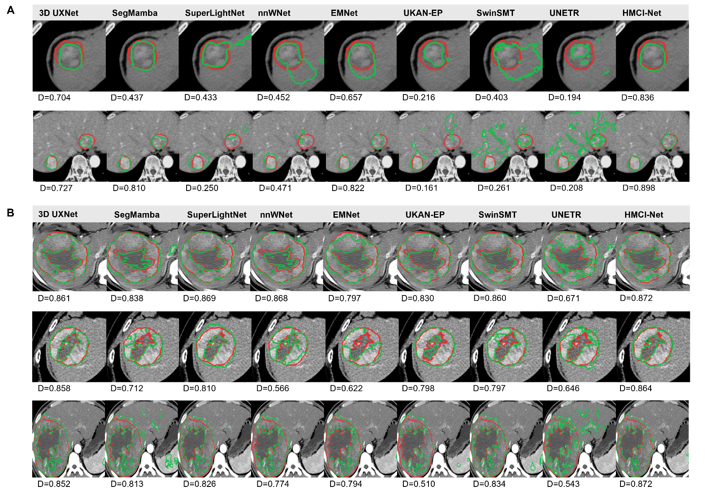
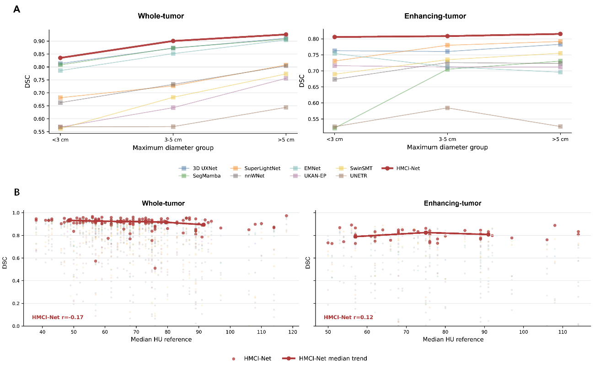

<div align="center">

# HMCI-Net

### 3D whole-tumor and enhancing-tumor segmentation

**Helical Mamba · Structural feature modulation · Cross-directional interaction**

Journal manuscript companion · PyTorch / MONAI · Contrast-enhanced CT

[Method](#method) · [Journal results](#segmentation-results) · [Quick start](#quick-start) · [Figure index](docs/figures.md) · [中文说明](README.zh-CN.md)

</div>

HMCI-Net is a 3D encoder–decoder network for segmenting whole tumors and intratumoral enhancing regions in hepatocellular carcinoma. This repository accompanies the manuscript:

> **Automated 3D Segmentation and Quantification of Whole and Enhancing Tumor Burden in Hepatocellular Carcinoma: Multicenter Validation and Prognostic Evaluation**

The repository presents the architecture, helical scanning strategy, full model comparisons, internal and external validation, detection performance, qualitative examples and robustness analyses from the journal manuscript. It provides the supplied network implementation and new configuration-driven training, inference and mask-evaluation entry points. Patient data, trained weights and exact journal experiment configurations are not included.

## Method




*New conceptual diagram based on manuscript Section 2.3. It summarizes the method, rather than reproducing a supplementary figure.*

| Component | Role | Implementation |
| :-- | :-- | :-- |
| Helical Mamba (HM) | Bidirectional sequence modeling of volumetric features | `ux_block`, `OScanner` |
| Multi-scale Structural Feature Modulation (MSFM) | Combine local and volumetric features with channel modulation | `TripleBranchFusion_KAN` |
| Cross-Directional Interaction (CDI) | Exchange directional information at the bottleneck | `HPA3D` |
| U-shaped decoder | Recover spatial detail using encoder skip features | `UXNET` |

The preserved implementation is in [HM.py](source/networks/Heiix_Mamba/HM.py). Its internal class names remain unchanged for checkpoint compatibility. Implementation details and source/manuscript differences are documented in [method.md](docs/method.md) and the [correspondence notes](docs/reproducibility.md#implementation-correspondence).

Whole-tumor and enhancing-tumor segmentation use **separate binary configurations and checkpoints**. The LiTS example uses a three-class background/liver/tumor output.

### Helical modeling and feature interaction

For each channel group, the same Mamba module processes the forward sequence and its reversal. Reversing the backward output back into the original order and averaging the two outputs produces a bidirectional representation. The three group outputs are restored to their feature grids and concatenated, followed by structural modulation and residual connections.

MSFM combines a volumetric 5 × 5 × 5 depthwise branch with a local 3 × 3 × 3 depthwise branch. The supplied implementation computes channel weights from average/max pooled features through KAN layers. CDI uses grouped directional average/max pooling and cross-branch spatial weighting at the bottleneck. See the [step-by-step method and equations](docs/method.md).

## Experimental coverage

| Experiment family | Available evidence |
| :-- | :-- |
| Journal internal comparison | 9 models × 2 segmentation tasks; patient-wise and tumor-wise DSC/JI |
| Journal generalization | 4 external datasets for whole tumors; HCC-TACE-Seg for enhancing tumors |
| Detection | Patient recall and tumor precision/recall/F1 in 7 task–cohort settings |
| Qualitative segmentation | Whole-tumor and enhancing-tumor reference/prediction contours (Fig. 3) |
| Robustness | Tumor-size and CT-attenuation analyses (Fig. 4) |
| Method | Four-stage encoder–decoder, HM, MSFM and CDI (Section 2.3) |

All reported experiment values and evaluation images on this page come from the journal manuscript. The architecture overview summarizes Section 2.3, and the cohort plot visualizes Table 3. Overlap scores use a 0–1 scale.

### Segmentation cohort allocation

| Task / dataset | Development cases | Internal test cases | External cases |
| :-- | --: | --: | --: |
| Whole tumor, institutional cohort | 482 | 205 | — |
| Enhancing tumor, institutional subset | 218 | 93 | — |
| LiTS | — | — | 131 |
| MSD Hepatic Vessels | — | — | 303 |
| CECT | — | — | 278 |
| HCC-TACE-Seg / TCIA-HCC | — | — | 92 |

*Manuscript Section 2.1 and Table 1, case counts only. The 311 enhancing-tumor cases are a subset of the 687 institutional cases, not additional patients. Public cohorts total 804 cases. These allocations describe the study; patient split files are not included.*

## Segmentation results

The following tables and figures use the **journal manuscript**. They are reported results, not newly run experiments. DSC and JI are on a 0–1 scale. Parentheses retain the manuscript's reported IQRs.

### Whole-tumor segmentation: all nine models

| Model | Patient DSC | Patient JI | Tumor DSC | Tumor JI |
| :-- | --: | --: | --: | --: |
| 3D UXNet | 0.886 (0.844-0.928) | 0.801 (0.738-0.864) | 0.888 (0.839-0.937) | 0.805 (0.736-0.875) |
| SegMamba | 0.852 (0.769-0.935) | 0.758 (0.656-0.860) | 0.884 (0.835-0.933) | 0.799 (0.730-0.868) |
| SuperLightNet | 0.710 (0.584-0.836) | 0.579 (0.446-0.711) | 0.777 (0.695-0.859) | 0.649 (0.550-0.748) |
| nnWNet | 0.715 (0.590-0.839) | 0.583 (0.452-0.714) | 0.772 (0.685-0.859) | 0.644 (0.541-0.748) |
| EMNet | 0.840 (0.755-0.925) | 0.740 (0.636-0.845) | 0.878 (0.823-0.933) | 0.790 (0.717-0.863) |
| UKAN-EP | 0.625 (0.471-0.779) | 0.490 (0.344-0.635) | 0.721 (0.623-0.818) | 0.582 (0.471-0.692) |
| SwinSMT | 0.673 (0.526-0.820) | 0.542 (0.398-0.686) | 0.736 (0.635-0.837) | 0.602 (0.487-0.718) |
| UNETR | 0.530 (0.393-0.667) | 0.385 (0.263-0.508) | 0.626 (0.533-0.719) | 0.470 (0.374-0.565) |
| **HMCI-Net** | **0.897 (0.850-0.945)** | **0.820 (0.753-0.887)** | **0.906 (0.866-0.945)** | **0.832 (0.774-0.891)** |

*Manuscript Table 2.* HMCI-Net's patient-wise DSC is 0.011 higher than the next-highest central estimate (3D UXNet), and its tumor-wise DSC is 0.018 higher. These are arithmetic differences, not significance claims.

### Enhancing-tumor segmentation: all nine models

| Model | Patient DSC | Patient JI | Tumor DSC | Tumor JI |
| :-- | --: | --: | --: | --: |
| 3D UXNet | 0.710 (0.608-0.812) | 0.569 (0.460-0.679) | 0.772 (0.693-0.852) | 0.642 (0.550-0.735) |
| SegMamba | 0.589 (0.461-0.717) | 0.442 (0.319-0.564) | 0.677 (0.580-0.774) | 0.528 (0.424-0.633) |
| SuperLightNet | 0.693 (0.570-0.815) | 0.555 (0.429-0.681) | 0.776 (0.709-0.843) | 0.644 (0.560-0.728) |
| nnWNet | 0.619 (0.463-0.774) | 0.482 (0.340-0.624) | 0.714 (0.622-0.806) | 0.571 (0.466-0.676) |
| EMNet | 0.668 (0.547-0.789) | 0.525 (0.403-0.648) | 0.714 (0.620-0.808) | 0.572 (0.464-0.680) |
| UKAN-EP | 0.625 (0.505-0.746) | 0.477 (0.361-0.593) | 0.713 (0.621-0.805) | 0.570 (0.468-0.672) |
| SwinSMT | 0.688 (0.567-0.809) | 0.549 (0.426-0.672) | 0.737 (0.649-0.824) | 0.598 (0.496-0.701) |
| UNETR | 0.384 (0.270-0.497) | 0.251 (0.161-0.341) | 0.541 (0.445-0.637) | 0.384 (0.291-0.478) |
| **HMCI-Net** | **0.801 (0.770-0.832)** | **0.671 (0.627-0.714)** | **0.811 (0.765-0.858)** | **0.688 (0.628-0.748)** |

*Manuscript Table 2.* The corresponding DSC differences are 0.091 patient-wise (versus 3D UXNet) and 0.035 tumor-wise (versus SuperLightNet).



*Manuscript Fig. 2. Upper row: whole tumors; lower row: enhancing tumors. Left: patient-wise evaluation; right: tumor-wise evaluation.*

### Internal and external validation



*New visualization of manuscript Table 3. Whiskers denote IQRs, not confidence intervals. [Editable SVG](docs/figures/journal_cohort_performance.svg).*

**Whole tumors**

| Cohort | Patient DSC | Patient JI | Tumor DSC | Tumor JI |
| :-- | --: | --: | --: | --: |
| Internal test | 0.897 (0.850–0.945) | 0.820 (0.753–0.887) | 0.906 (0.866–0.945) | 0.832 (0.774–0.891) |
| TCIA-HCC | 0.814 (0.640–0.871) | 0.687 (0.471–0.772) | 0.856 (0.754–0.899) | 0.748 (0.605–0.817) |
| LITS | 0.730 (0.652–0.829) | 0.575 (0.484–0.707) | 0.776 (0.675–0.844) | 0.634 (0.509–0.730) |
| MSD | 0.739 (0.632–0.825) | 0.586 (0.462–0.702) | 0.798 (0.719–0.855) | 0.663 (0.562–0.747) |
| CECT | 0.665 (0.573–0.760) | 0.499 (0.402–0.613) | 0.750 (0.659–0.797) | 0.600 (0.491–0.662) |

**Enhancing tumors**

| Cohort | Patient DSC | Patient JI | Tumor DSC | Tumor JI |
| :-- | --: | --: | --: | --: |
| Internal test | 0.801 (0.770–0.832) | 0.671 (0.627–0.714) | 0.811 (0.765–0.858) | 0.688 (0.628–0.748) |
| TCIA-HCC | 0.759 (0.675–0.845) | 0.612 (0.509–0.731) | 0.819 (0.725–0.859) | 0.693 (0.568–0.753) |

Across the four external whole-tumor cohorts, reported patient-wise DSC ranges from 0.665 to 0.814 and tumor-wise DSC from 0.750 to 0.856. Enhancing-tumor validation on TCIA-HCC reports 0.759 patient-wise DSC and 0.819 tumor-wise DSC. These are external-validation results, distinct from training a new model on the repository's LiTS example.

### Lesion detection performance

| Task | Cohort | Patient recall | Tumor precision | Tumor recall | Tumor F1 |
| :-- | --: | --: | --: | --: | --: |
| Whole tumor | Internal test | 0.927 | 0.942 | 0.927 | 0.935 |
| Whole tumor | TCIA-HCC | 0.804 | 0.920 | 0.805 | 0.860 |
| Whole tumor | LITS | 0.756 | 0.757 | 0.791 | 0.774 |
| Whole tumor | MSD | 0.809 | 0.873 | 0.813 | 0.842 |
| Whole tumor | CECT | 0.586 | 0.852 | 0.637 | 0.729 |
| Enhancing tumor | Internal test | 0.796 | 0.879 | 0.794 | 0.834 |
| Enhancing tumor | TCIA-HCC | 0.674 | 0.840 | 0.817 | 0.828 |

*Manuscript Table 3.* Patient recall measures detection among reference-positive cases. Tumor-level metrics use connected components and overlap-based detection as described in the manuscript. Voxel-wise precision/recall must not be substituted for these lesion-level quantities. The supplied Word does not contain the full per-model detection table referenced as Table S2; those unavailable values are not inferred from bar heights.

### Representative predictions



*Manuscript Fig. 3. Red contours: reference masks. Green contours: model predictions. Whole-tumor examples are shown above enhancing-region examples, with the same CT image used across model columns.*

### Robustness to lesion size and CT attenuation



*Manuscript Fig. 4. Panel A: maximum-diameter groups; panel B: attenuation–DSC relationship.*

| Task | DSC, <3 cm | DSC, 3–5 cm | DSC, >5 cm | Attenuation–DSC correlation |
| :-- | --: | --: | --: | --: |
| Whole tumor | 0.835 | 0.900 | 0.925 | Spearman r = −0.17 |
| Enhancing tumor | 0.806 | 0.808 | 0.815 | Spearman r = 0.12 |

*Values reported in the manuscript Results section.* Whole-tumor DSC increases across the reported size groups, while enhancing-region DSC varies less. Both reported attenuation correlations are weak; this does not establish independence from attenuation. The underlying per-lesion data and complete Tables S6–S7 were not supplied.

All journal comparison and cohort values are available as [structured JSON](docs/results/journal_results.json), with the [original extracted table text](docs/results/reported_segmentation_results.json) retained for auditing.

## Results and figure access

- [Complete figure index and provenance](docs/figures.md)
- [Full journal tables with IQRs and detection metrics](docs/experiments.md)
- [Detailed architecture and code mapping](docs/method.md)
- [Journal results JSON](docs/results/journal_results.json)
- Rebuild the cohort performance plot with `python tools/render_results.py` after installing `requirements-figures.txt`.

The figures cover segmentation methodology and model evaluation. Clinical baseline variables, Cox regression, prognosis ROC/AUC, survival curves and clinical volumetry agreement analyses are not displayed. The mixed clinical study-workflow figure is also omitted. No patient-level measurements are fabricated to fill unavailable supplementary tables.

## Quick start

Run all commands from the repository root. Use a CUDA-capable environment for model training and inference; the Mamba implementation requires its compiled dependencies. Install PyTorch for that environment first, followed by:

```bash
python -m pip install -r requirements.txt
python -m pip install -r requirements-cuda.txt --no-build-isolation
```

Dependency lists are not an experimentally verified lockfile. See [environment and verification status](docs/reproducibility.md#environment-and-verification).

### 1. Prepare image/mask pairs

```text
data/whole_tumor/
├── imagesTr/case_001.nii.gz
├── labelsTr/case_001.nii.gz
├── imagesVal/case_101.nii.gz
└── labelsVal/case_101.nii.gz
```

Use identical filenames, shapes and physical coordinates for each image/mask pair. Cases must be disjoint across development and validation splits. Binary labels are `0=background`, `1=target`; LiTS labels are `0=background`, `1=liver`, `2=tumor`. Inputs are single-channel CT volumes in HU. [Data preparation details](docs/data.md).

```bash
python -m hmci_net.train --config configs/whole_tumor.json --data data/whole_tumor --output outputs/whole_tumor --check-data
```

This checks configuration and filename pairing without importing the ML runtime. Voxel labels and geometry are checked when training loads each volume.

### 2. Train

```bash
python -m hmci_net.train --config configs/whole_tumor.json --data data/whole_tumor --output outputs/whole_tumor
python -m hmci_net.train --config configs/enhancing_tumor.json --data data/enhancing_tumor --output outputs/enhancing_tumor
```

For the public LiTS example, use `configs/lits.json` and the corresponding three-class masks. The supplied configurations are **starting points derived from the source example**, not verified journal experiment settings. They retain the fixed `128 × 128 × 128` patch size required by the source scan indices.

Training saves `best.pt`, `last.pt` and `final.pt`, plus the effective configuration and loss/validation log. `final.pt` records exactly the requested number of optimizer steps. Resume with `--resume outputs/whole_tumor/last.pt`; resumed augmentation order is not guaranteed to be bitwise identical.

### 3. Predict

```bash
python -m hmci_net.predict --config outputs/whole_tumor/config.json --checkpoint outputs/whole_tumor/final.pt --images data/whole_tumor/imagesVal --output outputs/whole_tumor/predictions
```

Sliding-window inference restores predictions to the input image's shape and affine. Predictions retain input filenames. Inference fails on checkpoint/key mismatches rather than silently loading partial weights.

### 4. Evaluate masks

```bash
python -m hmci_net.evaluate --predictions outputs/whole_tumor/predictions --references data/whole_tumor/labelsVal --label 1 --output outputs/whole_tumor/metrics.json
```

The evaluator reports per-case DSC/JI, their median and IQR, and patient detection recall among reference-positive cases. Use `--label 2` for LiTS tumor masks. It does **not** implement the manuscript's tumor-wise component matching or regenerate its reported tables. [Metric definitions and limits](docs/reproducibility.md#metrics).

## Repository layout

```text
HMCI-Net-Journal/
├── README.md / README.zh-CN.md
├── hmci_net/                 # New public training / prediction / evaluation API
├── configs/                  # Whole tumor, enhancing tumor and LiTS examples
├── source/                   # Python source preserved from the supplied archive
├── docs/
│   ├── figures/              # Manuscript segmentation figures and derived diagrams
│   ├── results/              # Journal segmentation results and extracted tables
│   ├── data.md
│   ├── reproducibility.md
│   └── source_manifest.json  # SHA256 hashes of the preserved source files
├── tests/                    # Data checks, geometry inversion and metric edge cases
└── requirements*.txt
```

The model implementation is retained in `source/`, with file hashes recorded for traceability. Use `python -m hmci_net...` for training, prediction and evaluation. All displayed scientific results are drawn from the journal manuscript.

## Development checks

```bash
python -m unittest discover -s tests -v
python tools/check_repository.py
```

The standard-library/NumPy tests do not require CUDA. MONAI geometry tests run when their dependencies are available; full Mamba execution requires a separately configured CUDA environment. Current results are recorded in [validation.md](docs/validation.md).

## Manuscript and attribution

Use the manuscript title above when referring to this work. Author names, target journal, DOI and final citation metadata have not been supplied; no publication or acceptance status is asserted here.

The supplied ZIP contains no license file. This package preserves the source and its provenance without assigning a new license to it. A distribution license and complete third-party attribution should be supplied by the rights holders before public release.

The implementation depends on PyTorch, MONAI, Mamba, timm and einops. The repository contains research code and examples; it does not include a clinical deployment workflow.
