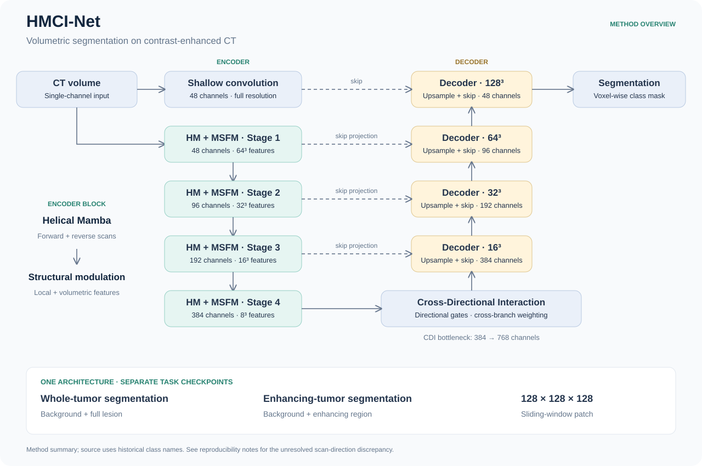

# HMCI-Net method and implementation

HMCI-Net combines a volumetric encoder, feature refinement, a directional bottleneck and a convolutional decoder. The manuscript describes four encoder stages. Whole-tumor and enhancing-tumor tasks use independent binary models; LiTS uses three output classes.

## Encoder and decoder

For a 128 × 128 × 128 patch, `uxnet_conv` produces four feature maps with widths 48, 96, 192 and 384 at spatial sizes 64³, 32³, 16³ and 8³. Each stage contains two `ux_block` instances. The decoder combines these features with convolutional skip projections and a full-resolution shallow convolutional feature. `HPA3D` expands bottleneck channels from 384 to 768 before the decoder.

The implementation uses the following class names: the top-level class is `UXNET`, the helical block is `ux_block`, the modulation class is `TripleBranchFusion_KAN`, and the CDI implementation is `HPA3D`. `hmci_net.model.build_model` configures these components without renaming their state-dict keys.

## Helical sequence construction

`OScanner` constructs an in-plane ring traversal, then reverses that traversal in alternating slices. It stores the resulting 3D voxel indices. `scan_tensor` serializes features using those indices; `restore_tensor` scatters the sequence back into its 3D grid.

For a sequence $S$ and reversal operator $R$, the per-group bidirectional representation is

$$
Z = \frac{M(S) + R(M(R(S)))}{2}.
$$

The same Mamba instance $M$ is used for both traversals within one group. The three groups have separate learned Mamba modules. Their restored feature maps are concatenated and combined with a residual feature map before structural modulation.

The manuscript describes depth/height/width directional modeling. The supplied implementation's second and third groups use the same axis permutation, although they have different weights. This correspondence issue remains unresolved; the repository does not silently change the trained computation.

## Multi-scale Structural Feature Modulation

The code implements a volumetric branch and a local branch:

$$
F_v = \operatorname{PWConv}(\operatorname{DWConv}_{5}(F)),
\qquad F_l = \operatorname{DWConv}_{3}(F).
$$

Average and max global pooling are combined, and two KAN layers produce channel weights:

$$
g = \frac{\operatorname{GAP}(F_v)+\operatorname{GMP}(F_v)}{2},
\qquad a = \operatorname{Softmax}(\operatorname{KAN}_2(\operatorname{KAN}_1(g))).
$$

The modulation output is

$$
F_{\mathrm{mod}} = (F_v \odot a) \odot F_l + F.
$$

The surrounding `ux_block` then applies channel normalization, learned layer scaling, stochastic depth and its outer residual connection. These equations describe the active `TripleBranchFusion_KAN` path, not the unused alternative modules also retained in the source file.

## Cross-Directional Interaction

CDI divides the feature channels into groups. Average and maximum pooling along pairs of axes create directional descriptors for the remaining axis. A shared convolution projects concatenated directional descriptors; sigmoid gates weight the grouped features along each spatial direction. Each branch is normalized.

After flattening spatial dimensions, globally pooled channel descriptors from one branch weight the spatial features of the other branch. The two cross-branch responses are added and passed through a sigmoid. This spatial gate modulates the original grouped input, after which the group dimension is restored and a grouped pointwise convolution doubles the channel count.

## Manuscript correspondence

The overview summarizes manuscript Section 2.3, with feature-grid and channel details checked against the included implementation. The manuscript refers to Supplementary Material 4 and Figs. S1–S2 for detailed formulations; those files were not supplied. The overview is a repository illustration, not a reproduced supplementary figure. [Reproducibility notes](reproducibility.md) describe implementation correspondence and configuration limits.
